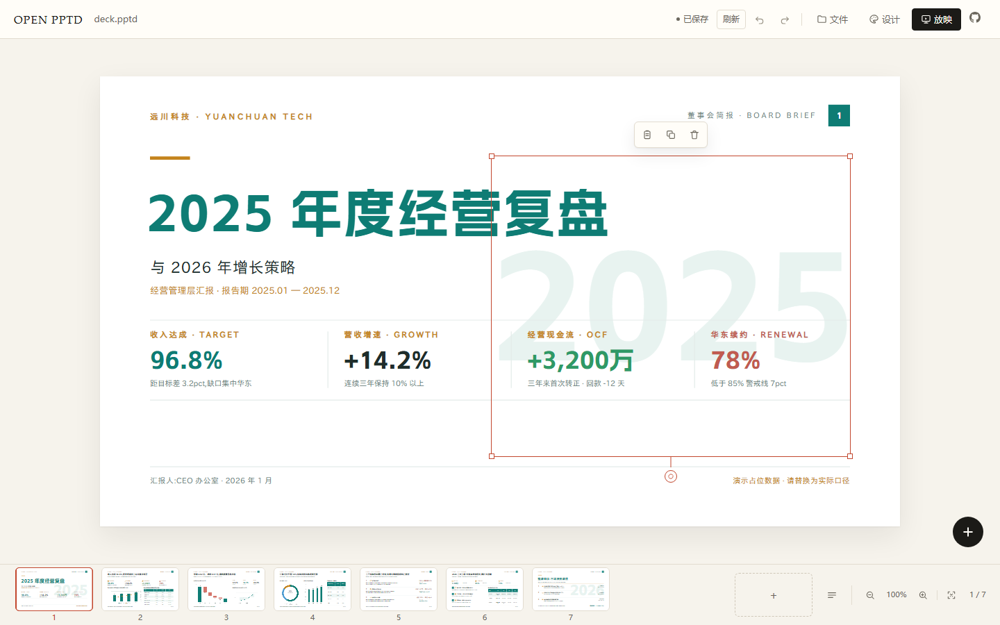

<div align="center">

# open-pptd

**Say one sentence to your AI — get an editable deck or poster, exported as native PPTX.**

`v3.0.0` · `MIT` · `Node ≥ 18` · `contract 3.0` · zero dependencies · zero build

[README.zh-CN.md](README.zh-CN.md) · [Online gallery](https://shingwha.github.io/open-pptd/) · [Release workflow](docs/release-workflow.md)



</div>

## 30-second setup

The only prerequisite: **Node.js ≥ 18**.

**Windows (PowerShell)**

```powershell
irm https://raw.githubusercontent.com/Shingwha/open-pptd/main/install.ps1 | iex
```

**macOS / Linux**

```sh
curl -fsSL https://raw.githubusercontent.com/Shingwha/open-pptd/main/install.sh | sh
```

This installs into `~/.open-pptd` and adds a user-level PATH entry (no admin needed). Or skip installing: clone this repo and run `node bin/open-pptd.js …`.

```sh
open-pptd open <project-dir> --detach --json   # editor in the browser, edits refresh live
open-pptd build <project-dir>/deck.pptd --format pptx
open-pptd check <project-dir>/deck.pptd        # read-only validation
open-pptd assets list                          # fonts / icons / themes
open-pptd doctor                               # environment self-check
```

## Use it with AI

Install the skill into your agent's skills directory (`~/.claude/skills` for Claude Code, `~/.pi/agent/skills` for pi, or the directory your tool documents), then just describe the deck. Three sources, in order of preference:

```sh
# A. CLI install (recommended; --force replaces an existing install)
open-pptd assets skill install --dir ~/.claude/skills

# B. Release zip: stable latest name (or a pinned open-pptd-skill-v3.0.0.zip)
curl -L -o open-pptd-skill.zip https://github.com/Shingwha/open-pptd/releases/latest/download/open-pptd-skill.zip
unzip open-pptd-skill.zip -d <skills-dir>
# PowerShell: Invoke-WebRequest https://github.com/Shingwha/open-pptd/releases/latest/download/open-pptd-skill.zip -OutFile open-pptd-skill.zip
#             Expand-Archive open-pptd-skill.zip -DestinationPath <skills-dir>

# C. Source fallback: copy skill/ from this repository
cp -r skill <skills-dir>/open-pptd
```

The former standalone `open-pptd-skill` repository is archived; `skill/` in this repository is the single source.

The AI delivers **two things**: an editable PPTD project directory (manifest + pages + media) and a ready-to-send `.pptx` (fonts embedded, opens in PowerPoint without repair).

## What it does

- **PPTD, not a black box** — the AI writes a human-readable YAML project (manifest + pages + media) you can edit by hand; `open` shows every page as it is written.
- **Minimal web editor** — text/table/chart content editing, drag/resize with alignment guides, multi-select, page insert/delete/reorder, and a Design panel for themes, color tokens, fonts and light/dark.
- **Native PPTX + PNG** — native, editable PowerPoint (fade transitions), per-page PNG, and a project bundle. Preview and PNG share one layout/paint pipeline; minor typographic differences from the browser are expected.
- **Charts, shapes, icons, formulas** — 13 chart types with a data grid, 187 preset shapes + custom paths, ~2000 Font Awesome icons, LaTeX formula mixing.
- **Themes and fonts** — built-in theme and font libraries, subset/full font embedding with a pre-export health check (`build --fetch` completes missing fonts).
- **6 kits for the AI** — academic, business-review, consulting-report, brand-proposal, lecture, poster.

## Upgrading from 2.x

Old commands are removed: `serve` → `open`, `export` → `build --format pptx`, `render` → `build --format png`; `export-project` → `build --format bundle`, `ensure` → `check` / `build --fetch`, `paths` → `doctor`. Full map: [CHANGELOG.md](CHANGELOG.md).

Release packaging and the version bump/tag checklist: [docs/release-workflow.md](docs/release-workflow.md).

## License

MIT · icons by [Font Awesome Free](https://fontawesome.com/license/free) (CC BY 4.0)
