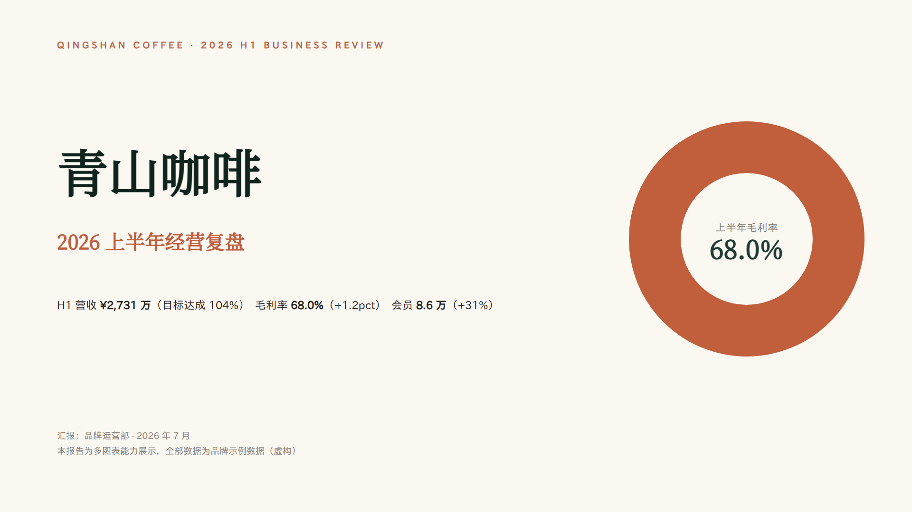
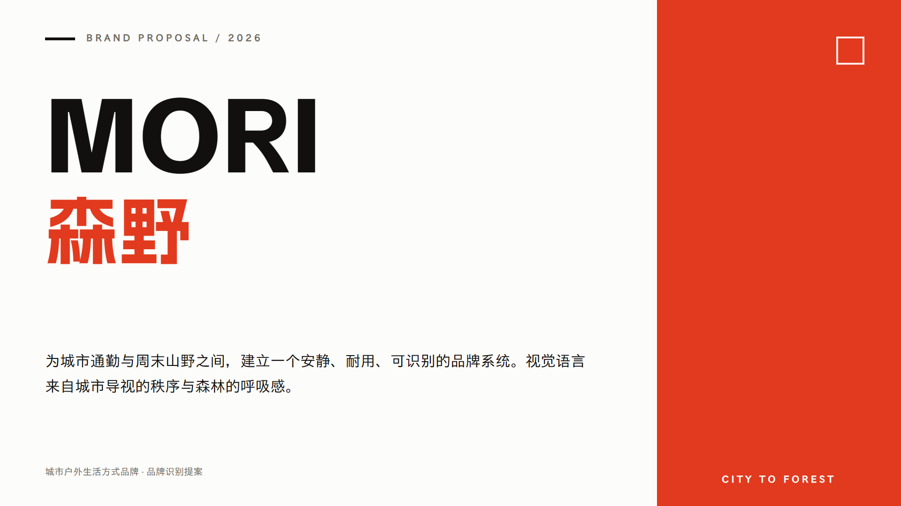
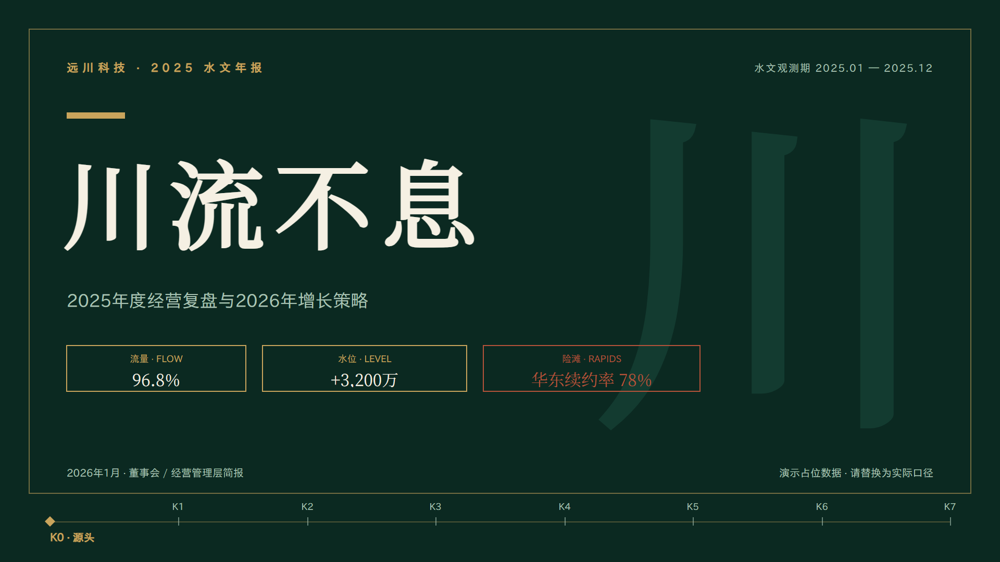
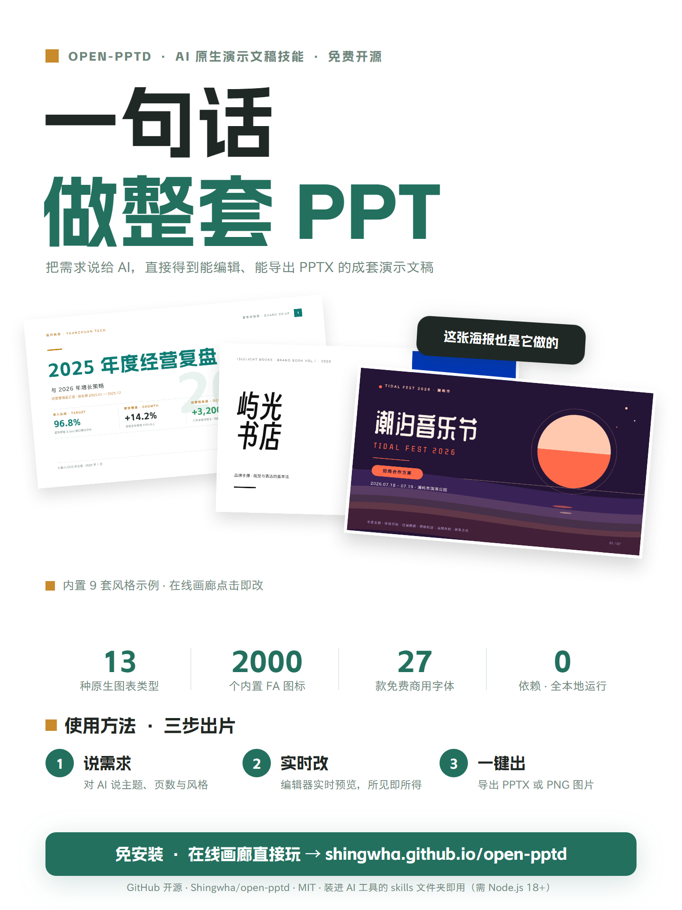
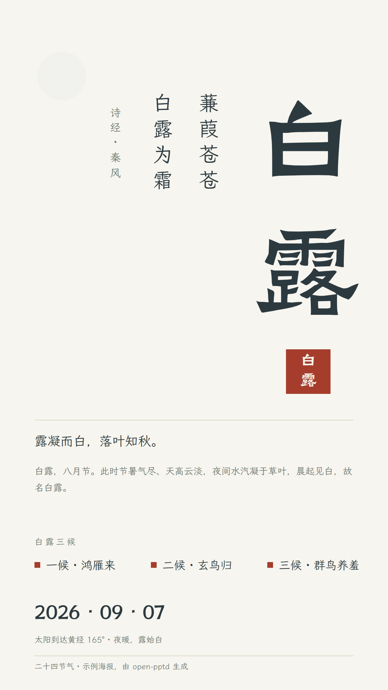

<div align="center">

# open-pptd

**Say one sentence to your AI — get an editable deck or poster, exported as native PPTX.**

`v3.0.0` · `MIT` · `Node ≥ 18` · `contract 3.0` · `zero dependencies · zero build`

[Online gallery](https://shingwha.github.io/open-pptd/) (no install, click & edit) · [30-second setup](#30-second-setup) · [Use it with AI](#use-it-with-ai)


</div>

---

Chinese: [README.zh-CN.md](README.zh-CN.md)

## 30-second setup

The only prerequisite: **Node.js ≥ 18**.

**Windows (PowerShell)**

```powershell
irm https://raw.githubusercontent.com/Shingwha/open-pptd/main/install.ps1 | iex
```

**macOS / Linux**

```sh
curl -fsSL https://raw.githubusercontent.com/Shingwha/open-pptd/main/install.sh | sh
```

This installs into `~/.open-pptd` and adds a user-level PATH entry (no admin needed); `open-pptd` is then available everywhere. Open a deck and produce a file:

```sh
open-pptd open <project-dir> --detach --json   # editor in the browser; edits refresh live
open-pptd build <project-dir>/deck.pptd --format pptx
open-pptd doctor                               # environment self-check (CLI / Node / assets / PATH / PNG)
```

Or skip installing: clone this repo and run `node bin/open-pptd.js open …` — same result.

## Use it with AI

Install the skill package into your AI tool's skills directory (`~/.claude/skills` for Claude Code, `~/.pi/agent/skills` for pi, others per your tool's configuration). Two ways:

```sh
# A. Release zip: download open-pptd-skill-v3.0.0.zip from Releases and unzip it
#    into your skills directory (the zip has a single top-level open-pptd/).
#    PowerShell: Expand-Archive open-pptd-skill-v3.0.0.zip -DestinationPath <skills-dir>
unzip open-pptd-skill-v3.0.0.zip -d <your-skills-directory>

# B. From this repository:
cp -r skill <your-skills-directory>/open-pptd
```

The former standalone `open-pptd-skill` repository is archived; `skill/` in this repository is the single source of the methodology.

Then just talk — no configuration needed:

- "Make me a 7-page annual business review; tell the story with charts"
- "Turn this outline into a presentation" + paste the outline
- "Design a Bailu solar-term poster"

The AI delivers **two things**: an editable PPTD project directory (manifest + pages + media), and a ready-to-send `.pptx` (fonts embedded, opens in PowerPoint without repair). To watch it being built live, have the AI run the `open` command above — every page appears as it's written.

## What it does

| | |
|---|---|
| **Charts** | 13 types with an Excel-style data grid — edit the numbers, the chart follows |
| **Shapes / icons** | 187 preset shapes + custom paths; ~2000 Font Awesome icons (three styles) in rendering and export |
| **Typography** | LaTeX formula mixing; font embedding (subset / full, with a pre-export health check; `build --fetch` completes missing fonts explicitly) |
| **Web editor** | Content editing for text, tables and charts; drag/resize with alignment guides; multi-select (Ctrl-click / Shift / marquee); page insert, delete and drag-reorder; Design panel for themes, color tokens, fonts and light/dark appearance |
| **Export** | Native `.pptx` (fade transitions), per-page PNG, and a project bundle |
| **Round-trip** | Download online work as a project bundle, or "Open Folder" to edit local projects directly |

**Preview and PNG share one pipeline; PPTX stays native.** The browser preview and PNG export run through the same layout/paint pipeline, guarded page-by-page by a 156-page golden baseline. The `.pptx` is a native, editable PowerPoint document rather than a pixel screenshot, so minor typographic differences from the browser preview are expected.

## How it works

```
your words ──AI (open-pptd skill)──▶ PPTD project (human-readable YAML: manifest + pages/ + media/)
                                          │
                      ┌───────────────────┴──────────────────┐
                web editor live preview                   PPTX export
                      └──────── same rendering pipeline ────┘
```

- **This repo**: the engine (packages/*) + web editor + CLI + the skill (`skill/`). Zero npm dependencies, zero build steps, fully self-developed
- **`skill/`**: the methodology the AI reads (SKILL.md + references + 6 kits: academic, business-review, consulting-report, brand-proposal, lecture, poster)
- The font library (~155 MB) is not bundled: `build` reports what a deck needs and `build --fetch` (or `open-pptd assets sync fonts`) downloads only that

## Example gallery

<p align="center">
  <a href="https://shingwha.github.io/open-pptd/editor/?deck=examples%2Fqingshan-coffee-review-12p%2Fdeck.pptd"></a>
  <a href="https://shingwha.github.io/open-pptd/editor/?deck=examples%2Fbrand-mori-showcase-7p%2Fdeck.pptd"></a>
  <a href="https://shingwha.github.io/open-pptd/editor/?deck=examples%2Fbusiness-review-7p%2Fdeck.pptd"></a>
</p>
<p align="center">
  <a href="https://shingwha.github.io/open-pptd/editor/?deck=examples%2Fxiaohongshu-intro-poster%2Fdeck.pptd"></a>
  <a href="https://shingwha.github.io/open-pptd/editor/?deck=examples%2Fposter-artdeco-latelier%2Fdeck.pptd"></a>
  <a href="https://shingwha.github.io/open-pptd/editor/?deck=examples%2Fposter-bailu-solar-term%2Fdeck.pptd"></a>
</p>

More examples (data annuals, pitch decks, architecture reviews, festival posters) live in the [online gallery](https://shingwha.github.io/open-pptd/) and the `examples/` directory — every card opens as an editable project.

## CLI quick reference

Five commands, no aliases (contract 3.0). Human text goes to stderr; `--json` prints one line on stdout.

| Command | What it does |
|---|---|
| `open-pptd open [dir] --detach --json` | Editor / Home (auto-detects the deck; `--stop` ends it, `--blank` for an empty deck) |
| `open-pptd build <deck.pptd> --format pptx\|png\|bundle` | Produce a PPTX / per-page PNGs / project bundle (full check first; `--strict`, `--fetch`) |
| `open-pptd check <deck.pptd> [--json] [--strict]` | Read-only validation: schema / tokens / resources / geometry / contrast |
| `open-pptd assets list\|sync\|themes\|fonts` | Font, icon and theme libraries (built-in + `~/.open-pptd`) |
| `open-pptd doctor [--json]` | Environment, every path, library counts and Chrome/Edge (PNG) capability |

### Migrating from 2.x

Old commands are removed (they exit 1 and print the target command):

| 2.x | 3.0 |
|---|---|
| `serve` | `open` |
| `export` | `build --format pptx` |
| `export-project` | `build --format bundle` (`--raw` for verbatim files) |
| `render` | `build --format png` |
| `ensure` | `check` (read-only) / `build --fetch` (explicit font download) |
| `paths` | `doctor` |
| `gallery scan` | `open` (Home) / `node scripts/gen-gallery-manifest.mjs` (release) |
| `fonts …` / `icons …` | `assets fonts …` / `assets sync` |

## Releasing

Release packaging and the version bump/tag checklist: [docs/release-workflow.md](docs/release-workflow.md).

## License

MIT · icons by [Font Awesome Free](https://fontawesome.com/license/free) (CC BY 4.0)
