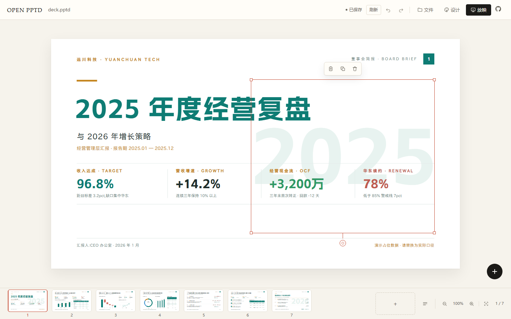
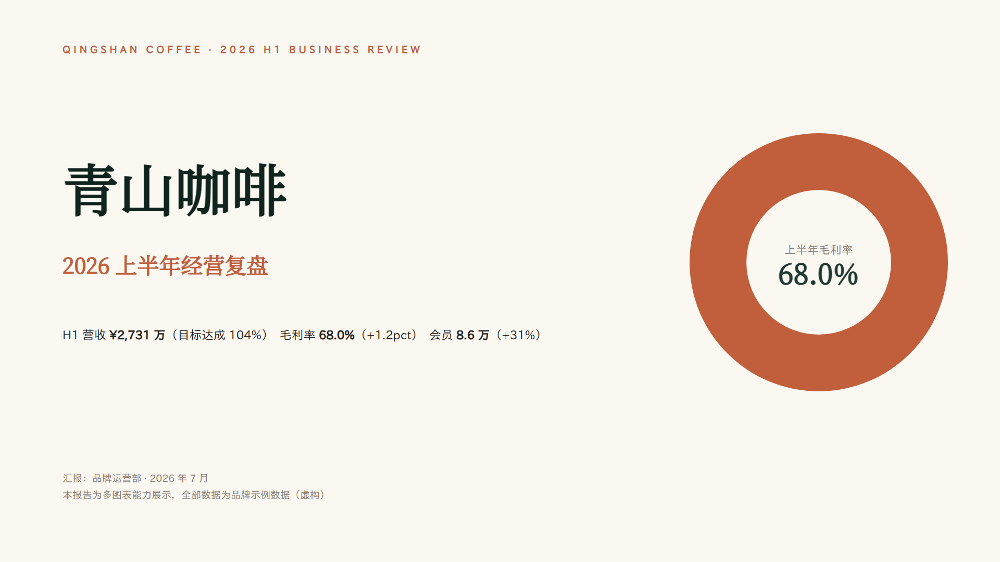
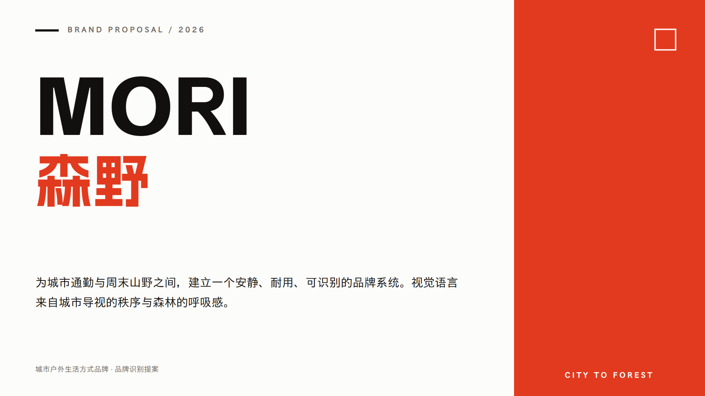
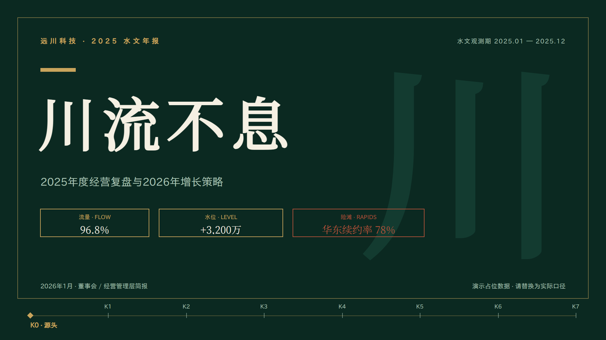
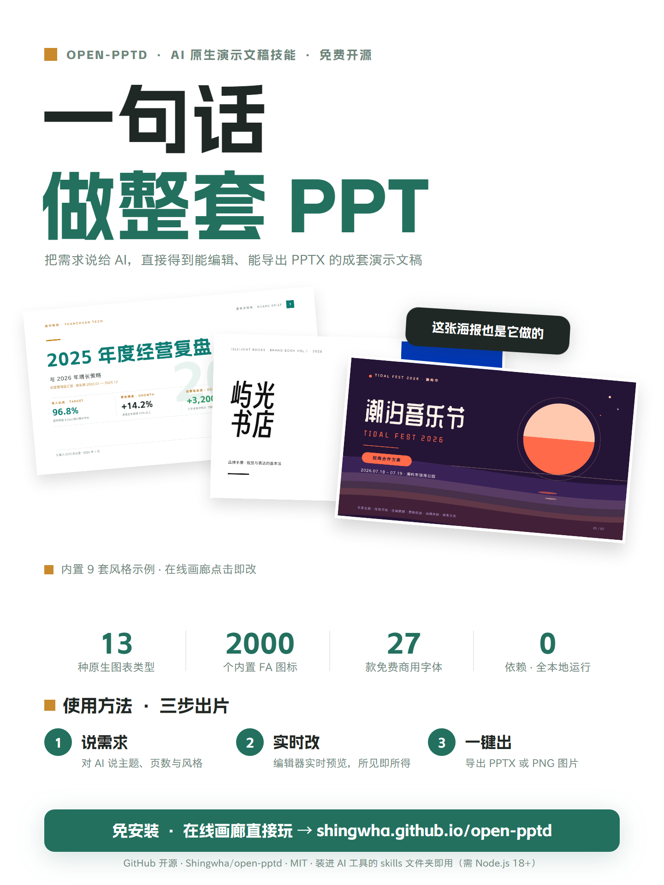
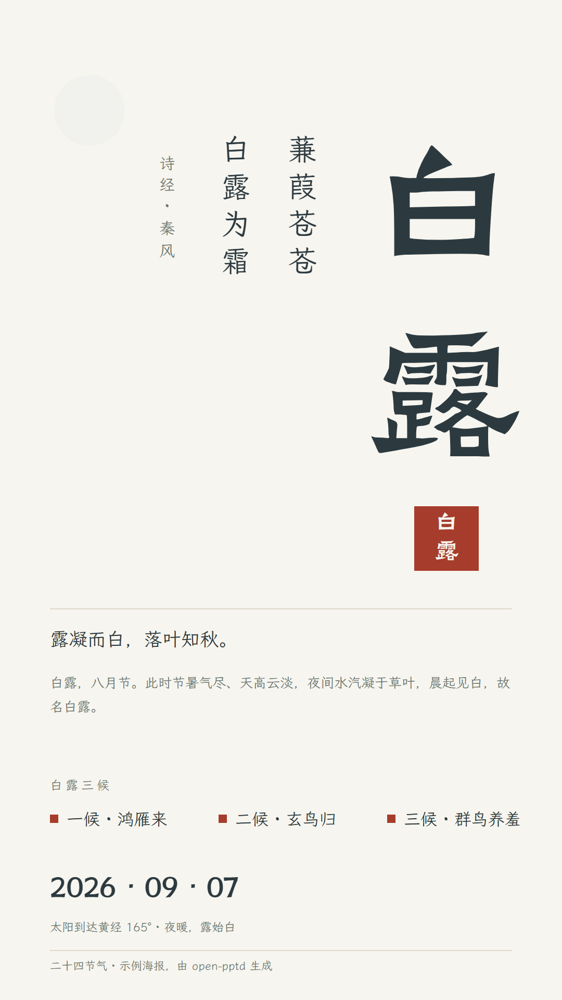

<div align="center">

# open-pptd

**对 AI 说一句话，得到可编辑的 PPT 与海报，导出为原生 PPTX。**

`v3.0.0` · `MIT` · `Node ≥ 18` · `contract 3.0` · `零依赖 · 零构建`

English: [README.md](README.md)

[线上画廊](https://shingwha.github.io/open-pptd/)（免安装，点开即改）· [30 秒安装](#30-秒上手) · [和 AI 一起用](#和-ai-一起用)



</div>

---

## 30 秒上手

前置只有一个：**Node.js ≥ 18**。

**Windows（PowerShell）**

```powershell
irm https://raw.githubusercontent.com/Shingwha/open-pptd/main/install.ps1 | iex
```

**macOS / Linux**

```sh
curl -fsSL https://raw.githubusercontent.com/Shingwha/open-pptd/main/install.sh | sh
```

装到 `~/.open-pptd` 并写入用户级 PATH（不需要管理员），装完 `open-pptd` 全局可用。打开项目并产出文件：

```sh
open-pptd open <项目目录> --detach --json   # 浏览器打开，改文件实时刷新
open-pptd build <项目目录>/deck.pptd --format pptx
open-pptd doctor                            # 环境自检（CLI / Node / 资源 / PATH / PNG）
```

不装也行：clone 本仓库后 `node bin/open-pptd.js open …` 效果相同。

## 和 AI 一起用

把技能包装进 AI 工具的技能目录（Claude Code 在 `~/.claude/skills`，pi 在 `~/.pi/agent/skills`，其他工具按其配置）。两种装法：

```sh
# A. Release zip：下载 open-pptd-skill-v3.0.0.zip，解压到技能目录
#    （zip 顶层只有一个 open-pptd/）。
#    PowerShell: Expand-Archive open-pptd-skill-v3.0.0.zip -DestinationPath <技能目录>
unzip open-pptd-skill-v3.0.0.zip -d <技能目录>

# B. 从本仓库拷贝：
cp -r skill <技能目录>/open-pptd
```

原独立 `open-pptd-skill` 仓库已归档；本仓库的 `skill/` 是方法论的唯一来源。

然后直接说人话，无需任何配置：

- 「帮我做一份 7 页的年度经营复盘，用图表讲故事」
- 「把这份大纲做成演示文稿」+ 粘贴大纲
- 「做一张白露节气主题海报」

AI 会交付**两样东西**：可编辑的 PPTD 项目目录（manifest + pages + media），以及可直接发送的 `.pptx`（字体已嵌入、PowerPoint 打开零修复）。想围观生成过程，让 AI 跑上面的 `open`，每写一页你就能看到。

## 能做什么

| | |
|---|---|
| **图表** | 13 种类型，Excel 式数据网格改数即改图 |
| **形状 / 图标** | 187 种预置形状 + 自定义路径；约 2000 个 Font Awesome 图标（三风格），用于渲染与导出 |
| **排版** | LaTeX 公式混排；字体嵌入（子集 / 完整，导出前体检；`build --fetch` 显式补齐缺失字体） |
| **网页编辑器** | 文字 / 表格 / 图表内容编辑；拖动缩放 + 对齐参考线；多选（Ctrl 点选 / Shift / 框选）；页面插入、删除、拖拽排序；Design 面板管理主题、颜色令牌、字体与深浅色外观 |
| **导出** | 原生 `.pptx`（淡入淡出转场）、逐页 PNG、项目包 |
| **项目互通** | 线上作品可下载项目包带回本地，本地项目可「打开文件夹」直接编辑 |

**预览与 PNG 同管线，PPTX 保持原生可编辑。** 浏览器预览与 PNG 导出走同一条 layout/paint 渲染管线，由 156 页黄金基线逐页守门；`.pptx` 是原生、可编辑的 PowerPoint 文档而不是像素截图，与浏览器预览存在轻微字体度量/断行差异属正常现象。

## 原理

```
你说的话 ──AI（open-pptd skill）──▶ PPTD 项目（人类可读 YAML：manifest + pages/ + media/）
                                          │
                      ┌───────────────────┴──────────────────┐
                  网页编辑器实时预览                     PPTX 导出
                      └──────── 同一条渲染管线 ──────────────┘
```

- **本仓库**：引擎（packages/*）+ 网页编辑器 + CLI + 技能知识包（`skill/`）。零 npm 依赖、零构建，全部自研
- **`skill/`**：给 AI 看的方法论（SKILL.md + references + 6 个 kit：academic、business-review、consulting-report、brand-proposal、lecture、poster）
- 字体库（约 155 MB）不入包：导出时按需获取真正用到的，也可 `open-pptd assets sync fonts` 全量预存

## 示例画廊

<p align="center">
  <a href="https://shingwha.github.io/open-pptd/editor/?deck=examples%2Fqingshan-coffee-review-12p%2Fdeck.pptd"></a>
  <a href="https://shingwha.github.io/open-pptd/editor/?deck=examples%2Fbrand-mori-showcase-7p%2Fdeck.pptd"></a>
  <a href="https://shingwha.github.io/open-pptd/editor/?deck=examples%2Fbusiness-review-7p%2Fdeck.pptd"></a>
</p>
<p align="center">
  <a href="https://shingwha.github.io/open-pptd/editor/?deck=examples%2Fxiaohongshu-intro-poster%2Fdeck.pptd"></a>
  <a href="https://shingwha.github.io/open-pptd/editor/?deck=examples%2Fposter-artdeco-latelier%2Fdeck.pptd"></a>
  <a href="https://shingwha.github.io/open-pptd/editor/?deck=examples%2Fposter-bailu-solar-term%2Fdeck.pptd"></a>
</p>

更多示例（数据年报、BP、架构评审、音乐节海报等）见[线上画廊](https://shingwha.github.io/open-pptd/)与 `examples/` 目录——每张卡片点开就是一个可编辑的项目。

## CLI 速查

5 个命令，无别名（契约 3.0）。人类文本走 stderr；`--json` 时 stdout 只有一行。

| 命令 | 作用 |
|---|---|
| `open-pptd open [目录] --detach --json` | 编辑器 / Home（自动识别 deck；`--stop` 停止，`--blank` 空白） |
| `open-pptd build <deck.pptd> --format pptx\|png\|bundle` | 产出 PPTX / 逐页 PNG / 项目包（先跑完整体检；`--strict`、`--fetch`） |
| `open-pptd check <deck.pptd> [--json] [--strict]` | 只读体检：schema / 令牌 / 资源 / 几何 / 对比度 |
| `open-pptd assets list\|sync\|themes\|fonts` | 字体、图标、主题库（内置 + `~/.open-pptd`） |
| `open-pptd doctor [--json]` | 环境、全部路径、库计数与 Chrome/Edge（PNG）能力 |

### 从 2.x 迁移

旧命令已删除（执行会退出 1 并提示新命令）：

| 2.x | 3.0 |
|---|---|
| `serve` | `open` |
| `export` | `build --format pptx` |
| `export-project` | `build --format bundle`（`--raw` 原样文件） |
| `render` | `build --format png` |
| `ensure` | `check`（只读）/ `build --fetch`（显式下载字体） |
| `paths` | `doctor` |
| `gallery scan` | `open`（Home）/ `node scripts/gen-gallery-manifest.mjs`（发布） |
| `fonts …` / `icons …` | `assets fonts …` / `assets sync` |

## 发布

发布打包与版本 bump / tag 清单见 [docs/release-workflow.md](docs/release-workflow.md)。

## License

MIT · 图标基于 [Font Awesome Free](https://fontawesome.com/license/free)（CC BY 4.0）
